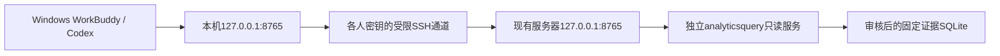

# 现有分析服务器上的固定证据查询：部署提案

2026-10-28，只读环境核实 + 本地模板。本轮没有上传、部署、建用户/密钥、启动/停止服务、
改监听/反代/防火墙/DNS/Google grant/timer/飞书。下面的变更步骤均待具体批准。

## 推荐拓扑与阶段边界

阶段一只共享已保存真实聚合证据：一案例、两个 provisional 版本、12 周趋势和逐页贡献。
它不是完整 V1 上线，不会因提问抓最新数据，也不依赖 Google 授权继续有效。
原 synthetic/confirmed 快照的旧协议保持兼容；当前真实案例不是 confirmed。

阶段二才涉及每日/按需最新、历史证据更新和长期认证，尚未实现/验收，不随阶段一上线。
同事通过统一协议读一个服务，不分发 root 私钥、Google/数据库凭据，也不各自维护采集项目。

选择 SSH 通道是为了复用既有 SSH 入口、避免新增公网 API 和当前未知的 HTTPS 鉴权配置。
“内部使用”没有被当作已存在专网：现有管理连接使用公网地址，是否有公司 VPN/SSO 未确认。
服务不能绑定 0.0.0.0；不在现有 Nginx 上直接增加一个未鉴权代理。
若团队不接受 SSH 通道，需另批受鉴权 HTTPS 方案、域名/证书及认证归属，本轮不实施。

## 已核实环境 / 不能推断的事项

- 生产 release `20260827T040021Z-aggregate-funnel-r3`，同步身份 websiteanalytics（nologin）。
- x86_64，Python 3.12.3，base `/usr/bin/python3.12`，SQLite 3.45.1，systemd 255；
  base 的 venv/ensurepip/sqlite3 模块存在，但未创建或安装新环境。
- PyYAML 6.0.3；原环境另有 Google/PyMySQL SDK，但阶段一不需要它们。
- 两项原 timer enabled/active waiting；读取时两项同步 oneshot 服务 inactive/dead。
  这只表示当时空闲，不保证之后没有按原计划正常运行。
- 原路径 `/opt/website-analytics/current`、venv、shared/cache/audits/sync-runs 保持原用途。
  shared 及下属数据目录归 websiteanalytics，权限 0700。
- 新查询目录和拟用 analyticsquery / analyticsquery-tunnel 用户/组尚不存在。
- Nginx 正在 80/443 的所有地址监听；8765/8766 没有监听。对 /etc/nginx 内最多32文件的
  限定检查实际检查13文件，未找到本分析服务或 GeneMedi 对应的专用鉴权入口。
  Nginx/TLS软件存在不等于有可安全复用的域名、证书或认证；没有读取私钥/密码文件。
- SSH 现有入口22可用，默认支持公钥和TCP转发。现有管理连接不是可分发给同事的最小权限身份；
  未证明已有合适的同事账户。新通道须单独建受限身份并逐人批准公钥。
- /opt 当时剩余约10.2 GiB。此次数据文件约0.3MB级，不需要先建数仓。

## 最小隔离部署对象（提议）

| 对象 | 提议 |
|---|---|
| 服务身份 | 新建 system 用户/组 analyticsquery，nologin、无sudo、无Google/DB/飞书访问 |
| 代码 | `/opt/website-analytics-query/releases/<reviewed-id>/src`，root所有；独立 current 链接 |
| 运行环境 | 同 release 下新 venv；用既有base Python3.12，**只装** requirements-query.txt 的 PyYAML6.0.3 |
| 证据 | `/var/lib/website-analytics-query/cases.sqlite`，root:analyticsquery，0640；目录0750；服务只读 |
| 服务文件 | `/etc/systemd/system/website-analytics-query.service`，来自本目录示例并经最终校验 |
| 监听 | 仅服务器127.0.0.1:8765，不新增防火墙/安全组/反代/DNS/证书 |
| 同事通道 | 新普通用户 analyticsquery-tunnel；没有sudo、shell、SFTP、代理转发；只许local forward到127.0.0.1:8765 |
| 通道授权 | root管理 `/etc/ssh/authorized_keys/analyticsquery-tunnel`；每人独立密钥，仅登记批准的公钥 |

不要在旧venv pip install，不要复制整个旧repo/config/环境/ADC/缓存，也不要把生产 current
改指开发 worktree。发布内容只需审核后的 src、独立依赖和既有聚合证据；不复制 sites.yaml、
analytics.env、凭据或SSH密钥。当前开发带既有未提交修正，发布按文件SHA审核，不以HEAD代替完整内容。

新 unit 没有 EnvironmentFile、GOOGLE_APPLICATION_CREDENTIALS、代理、同步 ExecStartPre、
--apply、timer 或对 cyber/原同步 unit 的依赖。只读目录+独立UID+隐藏旧路径避免碰源凭据。
256M/32 tasks 是提议资源限额，尚未在服务器真实unit下验收，可据受控压测再调整。

## 部署顺序（全部待批准后执行）

1. 本地冻结审核文件清单/哈希、用已有源数据离线导入并验证证据库，生成最终发布包及SHA。
   本轮准备了模板和内容清单，没有上传发布包。保留上一个查询版本与证据SHA作回退点。
2. 记录原生产 current 指向、原unit/timer文件哈希和 enabled/active 状态；不停止它们。
3. 仅创建新服务身份、查询目录与独立venv；新依赖安装范围限本目录。若venv/包源失败，报告；
   不改旧venv、全局Python、代理路由或网络来“修复”。新venv实际创建/安装尚未验证。
4. 上传审定代码及证据，校验完整哈希；目录/文件root所有，服务组只读。以新身份运行离线
   CaseStore验证，确认列案例与两种证据版本可读，证据文件不可写，旧shared与ADC不可读。
5. 审核新unit，先 `systemd-analyze verify`；经批准执行 daemon-reload/start **新unit**。
   验收前不enable。确认进程只绑定127.0.0.1:8765，没有新增对外监听。
6. 用管理员既有连接临时做8765→8765隧道，只读验证实际服务。通过后，是否开机启动需明确批准。
7. 另批同事访问：建 analyticsquery-tunnel 身份，备份sshd_config，追加示例为**文件末尾**Match块。
   不盲放到早期Include；必须完整 `sshd -t`，并用 `sshd -T -C user=analyticsquery-tunnel,...`
   检查 publickey/local转发/PermitOpen/MaxSessions0 生效，比较原管理用户配置没有变化。
   保留现有管理员SSH会话；验证通过且批准后仅reload ssh，不重启或改全局认证策略。
8. 每位同事本人在设备生成/保护自己的密钥，通过批准的安全渠道交公钥与指纹，由管理员逐人确认
   后登记；私钥不进聊天、repo、服务器或共享包。核验服务器公钥指纹，不自动信任陌生hostkey。

管理员执行的 systemd / SSH 配置写入、用户创建、SSH reload 和公钥登记均不在本轮许可内。
只读探测是已完成事实；上述上线命令与持久权限仍是待批准动作。

## Windows WorkBuddy / Codex 接入

使用已有 Windows OpenSSH（是否安装/企业策略允许尚未真机确认）。连接配置见
windows-ssh-config.example。运行 `ssh -N -T genemedi-analytics-read`，保留连接窗口即可；
没有远程shell和源码执行。不要把现有 root 私钥发给同事，也不复用 Google/飞书个人OAuth。

**本机与服务器端口都用8765**：应用校验 HTTP Host 的端口；只改成本机18765会正确返回403。
若8765被占用，应先确定两端一致的替代方案并测试，不能放松Host检查或公开绑定绕过。

不要求同事装完整项目：Windows可用 windows-list-cases.ps1.example 的.NET HTTP调用，
禁用环境代理/重定向。现有agent按 `batch-service/v1` 先list_cases、再case_versions，选定
evidence_id后问趋势/逐页，详见 docs/real-case-agent.md。Python现有package客户端也可用，
但它当前仍有包内依赖，不应宣传为已完成的独立单文件客户端。

本阶段只读请求列表；不接受任意SQL/path/command/remoteURL，不允许触发源抓取。
Windows脚本/受限SSH账号/端到端跨机均未验收，不声称同事已经接通。

## 只读验收清单

- 新身份无sudo/源凭据权限，旧同步文件/指向/timer配置不变；不继承旧.env、ADC或代理设置。
- 新服务只监听127.0.0.1:8765；外部不能直连。只读API仍拒绝SQL/path/命令/写入/未知操作。
- 列出真实case与两版本；保留provisional、结束未知、8月候选基线、正确的10月解释和大小写分离。
- 固定版本的双客户端、重启重放一致；库SHA前后不变，无源抓取。现有Mac本地已验证，
  服务器unit sandbox及Windows通道须上线审批后重新验证，不能沿用本地结果假装通过。
- 新通道仅可 -N 的local forward到8765；shell/exec/SFTP/-R/其他目标被拒绝；每个公钥可单独撤销。
- 同步正常按原计划继续；任何新服务失败只停/回退新服务，不停timer、不运行补齐或--apply。

## 回退

出现错误先停止/必要时disable **website-analytics-query.service**，关闭本次客户端通道。
首次部署无上一版时退回“没有共享服务”的状态，原生产同步继续；不要部署旧同步代码顶替。
升级时仅把新查询 current 链接和 cases.sqlite 恢复到已记录SHA的上个版本，再只启动查询服务。
保留失败版本/日志供审核，不删除原数据或凭据。

若撤销本次SSH接入，先移除/隔离本次批准的公钥，恢复本次sshd_config备份或移除唯一Match块，
`sshd -t`通过后reload ssh，确认原管理连接不变。不要删别人的key/配置，不改变全局root登录策略。
新系统用户是否保留为锁定、证据归档或删除须另批；默认停用、保留可恢复文件，不自动清理。

## 阶段二 / Google授权

每日/按需最新需要另行实现并验收有限来源刷新、截止/采样/缺日、URL历史、独立证据写入和监控。
刷新进程与只读服务应分离；不能把当前HTTP入口变成任意SSH/SQL/命令执行器，也不顺带改原timer。
新增计划任务、实时来源连接权限、按需刷新策略和部署必须单独批准，不能把阶段一称作完整V1。

10:02 UTC已有ADC标准refresh与最小GA4/GSC读均成功，文件mtime仍为10/22 02:40:29 UTC、0600，
没有续授权/替换；access token正常刷新不重置Testing grant的预计7天窗口。10/29约02:40 UTC
只是基于上次授权时间的提醒，不是已确认失效时间。

长期先核实当前OAuth应用从Testing进入Production的实际发布/验证前提；Workspace Internal/
Trusted仅在组织与账号条件真实满足、管理员批准后评估。服务账号需另证GA4/GSC资源只读权限
和安全凭据方式，不擅自切换或生成key。任何方案都不能保证token永久有效。

## 待用户确认的具体动作包

| 类别 | 待批准对象/动作 | 本轮状态 |
|---|---|---|
| 文件 | 新代码release、独立venv/PyYAML、只读cases.sqlite；审批最终SHA后上传 | 仅本地清单/模板 |
| 身份/服务 | 新analyticsquery用户组、新unit、daemon-reload/start；验收后是否enable | 未执行 |
| 监听 | 仅127.0.0.1:8765；不开放新公网/内网端口 | 未执行 |
| 访问 | 新analyticsquery-tunnel、sshd末尾Match、配置校验及reload | 未执行，需单独批准 |
| 凭据 | 指定同事名单、每人公钥/指纹的逐项登记；不处理私钥 | 人员/公钥未提供，未创建 |
| 明确不包含 | Nginx/域名/TLS/防火墙/VPN/Google授权/旧timer/源刷新/Feishu/网站变更 | 均未执行 |

技术依据：[OpenSSH sshd_config](https://man.openbsd.org/sshd_config) 的PermitOpen、local转发、
MaxSessions0；[systemd.exec](https://www.freedesktop.org/software/systemd/man/latest/systemd.exec.html)
的只读与不可访问路径；[Google OAuth应用状态](https://developers.google.com/identity/protocols/oauth2/production-readiness/overview)。
这些能力说明不等于本机生产模板已验收；本轮未安装unit/SSH配置，也未验证新账号实际连接。
