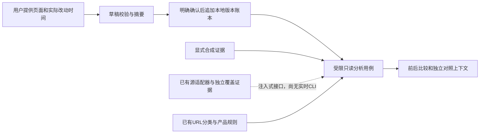

# 页面改动批次分析：本地纵向切片

状态：2026-10-28 本地开发，未部署。所有 `examples/batch-analysis` 数据均为人工合成，
不是实际优化批次、上线时间、网站流量或业务效果。本阶段保留旧看板，不建立新 UI。

## 模块与信任边界



- `analysis/contracts.py`：`batch-analysis/v1`、站点/URL/时间/窗口/筛选边界。
- `analysis/batches.py`：仅 `confirm` 写本地 SQLite；每个版本只追加，修订引用上一版本摘要。
  `get` 用 `mode=ro`，没有账本时拒绝，不自动建库；没有修改/删除历史的 API。
- `analysis/query.py`：`batch-metrics/v1`，只读确定性分析，复用 `reporting.compare_totals`。
- `analysis/readers.py`：精确匹配 scope 的合成证据；以及注入已有适配器的 `AdapterReader`。
  不创建 Google/数据库客户端，不加载 ADC、DSN 或运行环境，不执行同步。
- `adapters/ga4.py` 新增 `scoped_aggregate`：保持 host 白名单，源端按着陆页集合及可选
  `countryId` / `sessionDefaultChannelGroup` 筛选，区间无维度聚合，禁止相加页面或日 UV。
- `adapters/gsc.py` 仅给现有 `query_result` 加可选 `page_paths`；保留原分页、重试、final 数据。
- 现有分类、产品规则、询盘聚合适配器直接复用，不复制第二套分类或 SQL。

本阶段没有 HTTP/MCP 服务、网络监听或认证分发。旧 SSH worker 不作为团队服务发布。
后续服务应把同一用例暴露为受限内部请求，而不是让同事传代码、SQL、任意 URL 或 root 私钥。

## 契约与业务约定

草稿必填：`contract/site/batch_id/revision/previous_digest/title/description/pages/`
`published_at/published_timezone/sample`。可选 `control_pages/control_rationale`。

- 仅 `genemedi-net`；HTTPS GeneMedi URL 或绝对路径，禁止外域、用户信息、query、fragment、
  路径穿越及控制字符。调用已有 canonical path 规则做大小写、解码、末尾斜线统一。
  它不是 SEO canonical、重定向或页面家族模型；编码差异的真实源查询仍需后续验证。
- 每组最多 100 个路径，正则最长 4096 字符；超限拒绝，不能静默截断或扩大成全站。
- 必须给实际发布时间的 offset 与 IANA 时区，二者须匹配（包括夏令时）。
  非样例批次不允许确认未来“实际上线”时间。
- `draft` 无副作用，只显示规范化文档和 SHA-256；`confirm` 要求相同摘要及确认者标记。
  真正批次须由用户审核后再确认，命令的确认者字段不是身份认证或用户同意的替代品。
- 修订从 1 开始，下一版本引用前一摘要；冲突或重复保存失败。摘要用于检测内容变化，
  不提供签名、防管理员改库或生产审计的安全保证。

查询必须固定批次及版本，默认前后各 28 天，**排除实际上线所在整个本地日**，
后段从次日开始。可改为各 1–90 天，或给明确等长 before/after，不能跨入上线日。
窗口不是整周时显式提示。各来源保留自己的日期日界线，不把日聚合数据假装换算成统一时刻。

`selection` 仅允许：

| 条件 | 默认 | 作用 |
|---|---|---|
| `countries` | 空 | 显式 ISO alpha-2 格式国家代码，仅 GA4；无地理默认值 |
| `channels` | 空 | 显式 GA4 session default channel group 白名单，仅 GA4 |
| `pages` | 空 | 为空时整个确认批次；否则必须是已确认改动页面的子集，不能扩大范围 |

没有国家/渠道条件时，输出 `ordinary_traffic_target_visitors_undefined`。
有条件时仅称 `filtered_ga4_visitors`，仍不等于用户已批准“目标访客”的业务定义。
GSC 和询盘不会冒充这些 GA4 分群的转化结果。对照页不受改动页子集筛选影响，
继续使用确认的完整对照集合；国家/渠道条件对两组 GA4 同样应用。

## 指标、未知与证据

优先级为 GSC 搜索、GA4 访问、数据库询盘，各来源独立展示。

- GA4 使用源端整个区间的 cohort aggregate UV；sessions/engagedSessions 等原指标保留。
  engagementRate 由区间 engagedSessions/sessions 推导。keyEvents 是全部关键事件，非表单数。
- GSC 使用源端页面集合过滤后的区间汇总；CTR=clicks/impressions，position 使用源端汇总值。
  不平均页面 CTR 或排名，不保证 GSC 未截断就包含所有匿名/长尾明细。
- 询盘只用已存在的三个计数字段；非隔离不等于有效销售线索。URL 不可关联的数量为
  **站点级未知**，不能分给某批次、语言或访客分群；明细截断时未知数也未知。
  外域询盘整源失败，不静默删除、归入 GeneMedi 或合并。
- 语言目前按目录约定标记：`/ja` 为 ja；其他未识别双字母目录为 unknown。
  这不是浏览器语言，也不是上线证明。日语尚未上线的需求事实不会被样例模拟成实际流量。
  复用当前分类，`unknown_unmapped` 保持未知，不强行猜分类；完整页面家族/URL 历史待后续阶段。

每份源证据带 scope 摘要、抓取时间、日期边界、覆盖起止、缺日、完整截至日期、
cutoff_basis 和截断状态。来源成功不自动等于数据完整。

- `observed` / 明确的 `sample` 完整性证据才可能允许比较；配置滞后 `configured_lag`
  或 unknown 不能当成实际已完整日期。
- 覆盖不足、缺日、截断、未 finalized 或失败时保留已观察值，但对应 delta 和相对变化为 null。
  缺字段为 null；真正有证据的 0 保留为 0；零基数相对变化为 null。
- 对照只并列各组变化，不对不同规模的组做伪因果提升率；全程标记观察性前后比较。
- `generated_at` 是生成时间，`fetched_at` 是证据抓取时间，`complete_through` 是统计完整截至日。
  `result_digest` 不包含易变生成时间；同一版本、证据与状态下可复现。

CLI 目前**只接受显式合成样例证据**，不支持真实源结果伪装为 fixture。
`AdapterReader` 是程序接口，通过已有适配器注入，默认没有独立覆盖/完整性证据时返回 partial。
真实安全连接、来源运行元数据和不可变历史证据落盘尚未接入，不能据此宣称生产查询已验收。
GSC 最新可用/`all` 与首个不完整日期的读取也尚未实现，旧 `final` 行为未改变。

## 运行合成演示

在此 worktree 根目录，用已有开发解释器（没有安装或修改其依赖）：

```sh
/Users/dosthrk/dev-project/company/website-analysis/.venv/bin/python scripts/demo_batch_analysis.py --output-dir /tmp/website-batch-synthetic-demo
```

只创建本地 `synthetic-batches.sqlite` 和 `synthetic-report.json`。
自动确认仅限仓库中固定 `sample=true` 的合成数据，标记不是用户真实确认；再次执行复用相同
确认，不修改已有版本。示例报告应为 `sample=true/status=ok`：改动组 sessions 100→120，
GSC clicks 10→15、CTR 0.10→0.05，storedSubmissions 5→7；这些数值均为人工样例。

逐条体验确认流程：

```sh
export PYTHONPATH="$PWD/src"
python -m website_analytics.analysis draft --input examples/batch-analysis/draft.json
# 审阅输出后，将摘要填入下一条命令；使用已有 Python 环境。
python -m website_analytics.analysis confirm --input examples/batch-analysis/draft.json --digest <reviewed-digest> --confirmed-by synthetic-demo --store /tmp/batch-manual-demo.sqlite
python -m website_analytics.analysis query --request examples/batch-analysis/query.json --store /tmp/batch-manual-demo.sqlite --sample-evidence examples/batch-analysis/evidence.json
```

退出码：0 完整、2 输入/本地状态错误、3 部分结果。没有隐式真实源/全站/旧快照 fallback。

## 开发/生产兼容基线

开发起点：`2b534f686c1473a68f6bedcf9b58a97b5cce94d9` + 当时原工作区未提交的第一批修正，
复制到独立 `codex/change-batch-analysis` worktree；原 checkout 未覆盖、未提交。
生产公共源码/非秘密配置于 2026-10-28 06:30 UTC 只读核对：
`20260827T040021Z-aggregate-funnel-r3`，GA4 host 白名单 genemedi.net/www.genemedi.net，
GSC `https://www.genemedi.net/`。配置的 GA4/GSC/inquiry 2/3/1 日滞后是估计，不是本轮源数据探测。

| 差异 | 本阶段处理 |
|---|---|
| 开发有询盘边界声明/源 URL guard、V3 提前筛选和 sync_status | 原样保留继承，未改业务定义或同步行为 |
| 生产有 product_funnel、backfill、Feishu funnel 输出等五个额外模块 | 没有复制、覆盖或退役；不是本切片依赖 |
| 生产 product_mapping 多 engagedSessions/keyEvents/position 加权中间值 | 不宣称开发版与生产完全等价；新查询读源区间汇总，不部署开发 mapping 替代生产 |
| WorkBuddy 交付有 SSH worker、历史查询和独立源参考 | 只作参考，未合并 root SSH 成团队服务；Windows 真机验收仍欠缺 |

因此本阶段回归验证的是开发基线及新增契约的兼容性，**不是生产可直接部署证明**。
没有改变旧 CLI 命令参数、默认源行为、Feishu 字段/稳定键、同步计划或任何线上数据。

## 阶段验收与后续

- [x] 本地草稿校验、摘要确认、版本链、修订不覆盖、只读查询不创建/改写账本。
- [x] 明确合成数据，全流程样例、普通流量标签、可选筛选、未知分类、前后/独立对照。
- [x] 源端区间 UV、host 边界、限定过滤、缺失/截断/缺日/估计截至日不算效果、外域询盘失败。
- [x] 源适配旧接口回归；不需要 Google/飞书/数据库权限运行演示。
- [ ] 用户确认第一批真实页面、实际时间及目标访客条件；不将样例换名冒充真实批次。
- [ ] 真实只读集成：窗口完整性、GA4 限流/采样元数据、GSC 最新状态、CMS 全量映射对账。
- [ ] 不可变、版本化历史证据与源查询 fingerprint 落盘，重算/对账和有限历史迁移。
- [ ] 不分发 root 私钥的内部共享查询服务，两种 agent 一致性与访问边界验收。
- [ ] 真实 URL 改名/跳转/多语言页面家族与上线状态；稳定 Google 认证方案。
- [ ] 生产兼容验证、并行观察、部署/回退、定时任务及任何外部写入的单独审批。

测试命令：`python -m pytest -q`。测试使用固定样例/假客户端/临时文件；新增 CLI 集成测试
禁止 socket connect。Excel 渲染依赖不在该 worktree 时，既有渲染集成测试会跳过。
